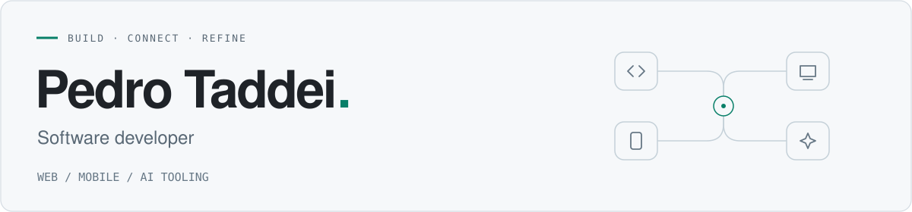

<picture>
  <source media="(prefers-color-scheme: dark)" srcset="assets/header-software-developer-dark.svg">
  <source media="(prefers-color-scheme: light)" srcset="assets/header-software-developer-light.svg">
  
</picture>

### Software for real workflows.

I'm **Pedro**, a software developer at **Biz Simplesnologia**, based in Brazil. I build business software, web and mobile products, and tools for AI-assisted development.

My work connects data models, APIs and interfaces — with particular attention to business rules, clear contracts and maintainable code.

#### What I work on

**Business systems**  
ERP features and integrations, from typed API contracts to the screens people use every day. Modernizing existing software while preserving its business rules.

**Web & mobile products**  
TypeScript applications with Next.js, React Native and Expo, backed by Fastify APIs. Shared packages keep schemas, types and API clients consistent across applications.

**AI developer tooling**  
Plugins, specialized agents and MCP servers. Review hooks and behavioral evaluations help make coding workflows more reliable; embeddings and vector search connect assistants to a personal knowledge base.

#### My toolkit

| Area | Technologies |
| :--- | :--- |
| Web | TypeScript · React · Next.js · Tailwind CSS |
| Mobile | React Native · Expo |
| Backend & data | Node.js · Fastify · Zod · Prisma · PostgreSQL · Supabase |
| Developer tools & AI | MCP · pgvector · Turborepo · pnpm · Vitest |

I value simple designs, explicit boundaries and tests that check behavior. Most of my work lives in private repositories; this profile is an overview of what I build.

---

<strong>Em português</strong>

### Software para o trabalho de verdade.

Sou o **Pedro**, desenvolvedor de software na **Biz Simplesnologia**, no Brasil. Construo sistemas de negócio, produtos web e mobile e ferramentas para desenvolvimento com IA.

Meu trabalho conecta modelos de dados, APIs e interfaces, com atenção às regras de negócio, contratos claros e código fácil de manter.

#### No que trabalho

**Sistemas de negócio**  
Funcionalidades e integrações de ERP, do contrato tipado da API às telas usadas no dia a dia. Modernização de software existente com preservação das regras de negócio.

**Produtos web e mobile**  
Aplicações TypeScript com Next.js, React Native e Expo, apoiadas por APIs Fastify. Pacotes compartilhados mantêm schemas, tipos e clientes HTTP consistentes entre as aplicações.

**Ferramentas de IA para desenvolvimento**  
Plugins, agentes especializados e servidores MCP. Hooks de revisão e avaliações de comportamento ajudam a tornar os fluxos de desenvolvimento mais confiáveis; embeddings e busca vetorial conectam assistentes a uma base pessoal de conhecimento.

Valorizo soluções simples, responsabilidades claras e testes que verificam comportamento. A maior parte do meu trabalho está em repositórios privados; este perfil apresenta o que construo.

